# YOONJU MARKET — 윤주(주)농업회사법인 농산물 자사몰

> 4트워크 · AX 액션러닝 과제 07. 천안의 로컬푸드 회사와 함께 만든 **B2C·B2B 농산물 자사몰**이다.
> 농가가 직접 상품을 올리고, 손님은 믿을 수 있는 정보를 보고 사며, 궁금한 것은 상품 정보로 답하는 상담 챗봇에게 묻는다.

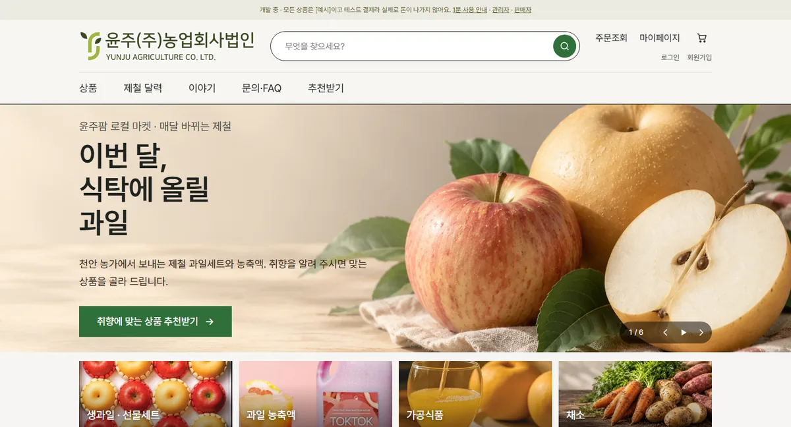

이 문서 하나만 읽어도 이 쇼핑몰이 **왜** 만들어졌고, **누가 무엇을** 할 수 있고, 각 기능이 **어떤 규칙으로** 움직이며, **어떻게 지키고 있는지** 알 수 있게 썼다. 숫자(몇 번, 며칠, 몇 개)는 모두 지금 코드에 들어 있는 값이다.

> **지금 상태:** 모든 상품·가격·농가·당도는 `[예시]`이고, 결제는 **테스트 결제**(실제 돈이 나가지 않음)다. 아직 누구나 여는 배포 주소는 없다. 자세한 것은 [12. 아직 못 한 것](#12-아직-못-한-것과-정해야-할-것).

## 목차

1. [왜 만들었나](#1-왜-만들었나)
2. [한눈에 보기](#2-한눈에-보기)
3. [화면 둘러보기](#3-화면-둘러보기)
4. [누가 쓰나: 손님 · 판매 농가 · 회사 관리자](#4-누가-쓰나)
5. [판매 농가가 들어와서 팔기까지 (가입 → 승인 → 자동 판매)](#5-판매-농가가-들어와서-팔기까지)
6. [손님이 사고 받기까지 (주문 → 결제 → 배송 → 확정 → 후기)](#6-손님이-사고-받기까지)
7. [취소 · 반품 · 환불](#7-취소--반품--환불)
8. [기능 하나하나](#8-기능-하나하나)
9. [보안과 개인정보](#9-보안과-개인정보)
10. [기술 구조](#10-기술-구조)
11. [실행하기 · 설정 · 시험](#11-실행하기--설정--시험)
12. [아직 못 한 것과 정해야 할 것](#12-아직-못-한-것과-정해야-할-것)
13. [더 자세한 문서](#13-더-자세한-문서)

---

## 1. 왜 만들었나

### 회사가 겪던 문제

윤주(주)농업회사법인은 충남 농가에서 받은 농산물을 가공·포장·판매하고, 과일 농축액(에이드 베이스)을 만들어 카페에도 납품한다. 기업 인터뷰에서 나온 문제는 세 가지였다.

| 문제 | 무엇이 불편했나 |
|---|---|
| **홈페이지가 회사 소개용** | 제품을 알리기만 하고 구매로 이어지지 않는다. 개인 판매는 쿠팡·스마트스토어에만 기대고 있다 |
| **"고당도"를 믿기 어렵다** | 말로만 된 설명이라 손님이 확인할 방법이 없다 |
| **물어볼 곳이 없다** | 처음 사는 농축액·농산물을 어떻게 먹는지, 언제까지 먹어야 하는지 물을 곳이 없다. 카페·식당의 대량 구매 문의 창구도 없다 |

### 그래서 만든 것

- **자체 주문·결제가 되는 자사몰**: 외부 마켓 링크가 아니라 이 사이트에서 장바구니 → 결제 → 배송 조회까지 끝난다. 회원이 아니어도 산다.
- **믿을 수 있는 정보**: 당도는 판매자가 잰 값과 **당도계 사진**을 함께 보여 주고, 공식 등급 기준(농산물 표준규격)으로만 '특·상'을 붙인다. 수확일, 보관법, 상품정보 제공 고시까지 상품마다 보여 준다.
- **새 상품까지 아는 상담 챗봇**: 상품을 등록하면 챗봇이 그 상품의 가격·재고·보관법·레시피를 바로 답한다. 자료에 없는 것은 지어내지 않고 담당자에게 넘긴다.
- **농가가 직접 파는 구조(샵인샵)**: 농가가 가입해 상품을 올리고 주문·배송·문의를 직접 처리한다. 회사는 승인과 확인을 맡는다.
- **기업(B2B) 구매 문의**: 카페·식당은 상품 화면에서 대량 구매·정기 납품 견적을 바로 요청한다.

### 성공 기준 (PRD v2)

기업이 사이트를 범용 호스팅에서 바로 운영할 수 있고, 새 상품을 등록하면 챗봇이 근거와 함께 답하며, 챗봇이 **지어낸 가격·정책은 0건**이어야 한다. 기획 문서: [docs/PRD.md](docs/PRD.md)

---

## 2. 한눈에 보기

| 항목 | 내용 |
|---|---|
| 화면 | 손님 쇼핑몰 `/` · 판매 농가 센터 `/seller` · 회사 관리자 `/admin` (로그인 주소는 하나: `/account/login`) |
| 상품 | 회사 실제 제품 11개(농축액 베이스 7종·과일세트 4종, 가격은 [예시]) + 예시 농가 18곳의 예시 상품 121개, 품목 27가지 |
| 결제 | 토스페이먼츠 결제위젯 (지금은 테스트 결제) |
| 상담 | 규칙·DB로 먼저 답하고, 손님이 원할 때만 AI (OpenRouter). 벡터 검색(RAG)으로 근거를 찾는다 |
| 기술 | React 19 + Vite 8 · Node.js 22 + Express 5 · PostgreSQL 16 · sharp · nodemailer |
| 시험 | 장애 대응 13/13, 환불·판매자 33/33, 판매자 상품 저장 10/10, 챗봇 질문 348개 중 정답 240 · 자신 있게 틀림 0 |

---

## 3. 화면 둘러보기

### 첫 화면

| 상품 목록 | 제철 달력 |
|---|---|
| 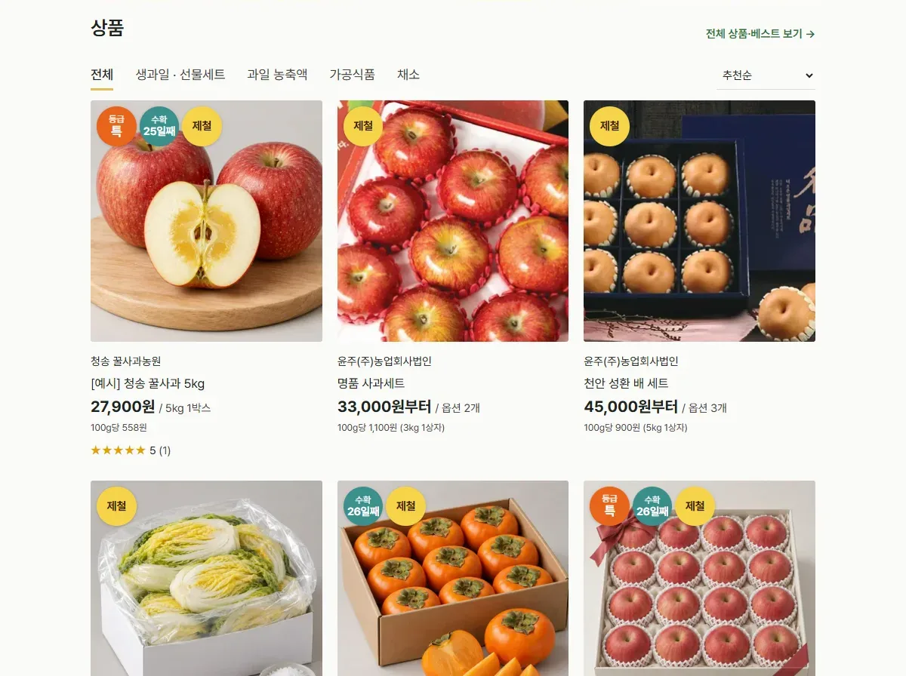 | 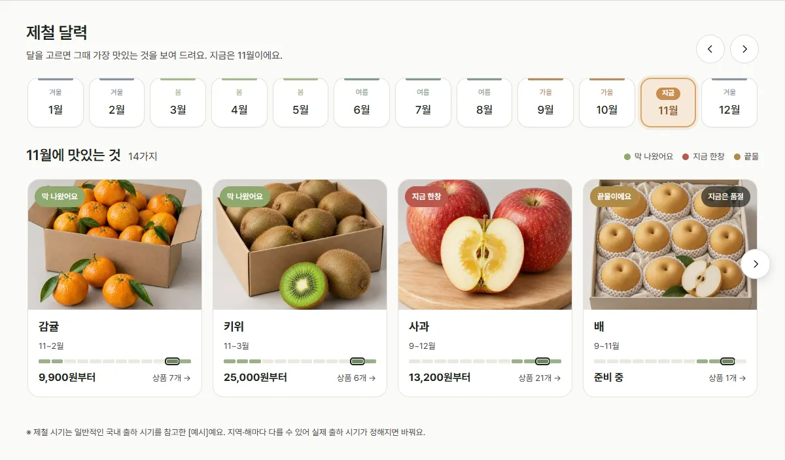 |
| 카테고리(생과일·선물세트 / 과일 농축액 / 가공식품 / 채소) 탭과 정렬. 사진 위 동그라미는 **당도 등급(특·상)**, **수확 ○일째**, **제철**. 카드에서 바로 장바구니에 담는다 | 달을 고르면 그 달 제철 품목을 실제 상품 사진 카드로 보여 준다. 막 나왔어요·지금 한창·끝물, 가장 싼 값, 상품 수. 카드는 한 줄에 4개, 나머지는 옆으로 넘긴다 |

| 회사 이야기 | 자주 묻는 질문과 회사 정보 |
|---|---|
| 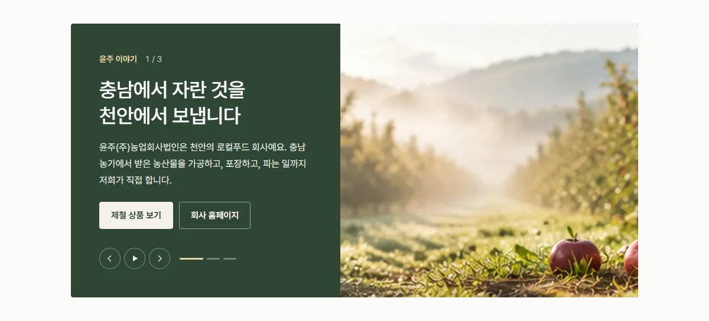 | 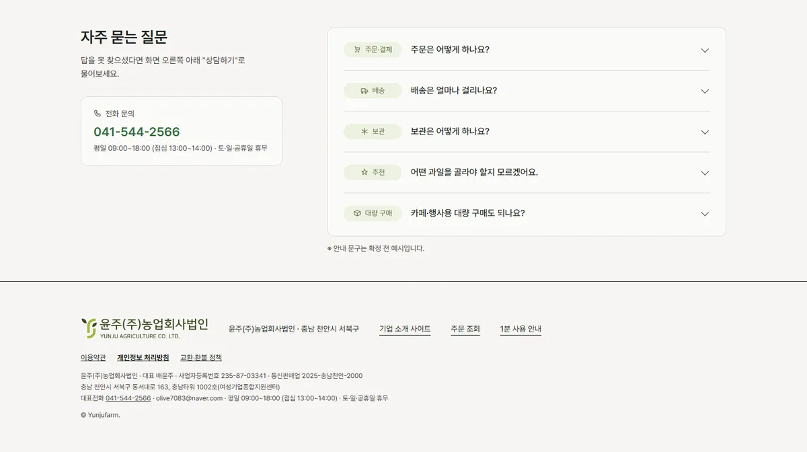 |
| 회사 소개 3장짜리 슬라이드 배너 (움직임 줄이기 설정이면 멈춘 채로) | 법으로 필요한 사업자 정보·약관 링크는 맨 아래에 |

### 헤더 검색과 상담

| 헤더에서 바로 검색 | 상담 챗봇 |
|---|---|
| 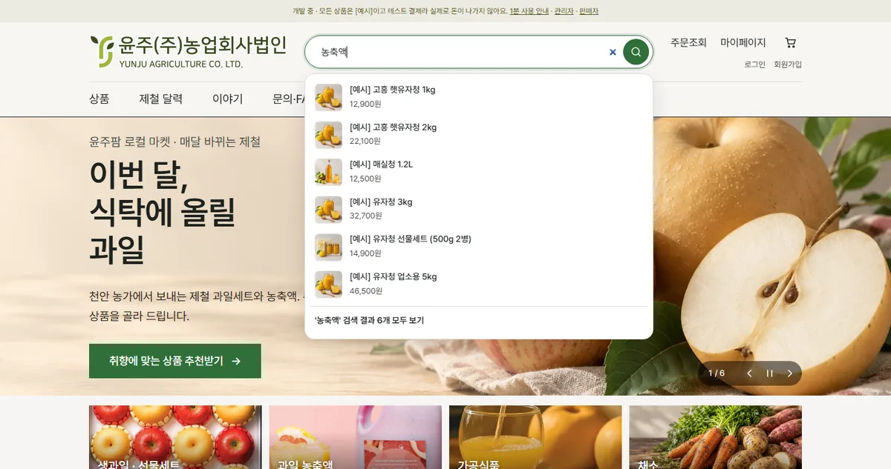 | 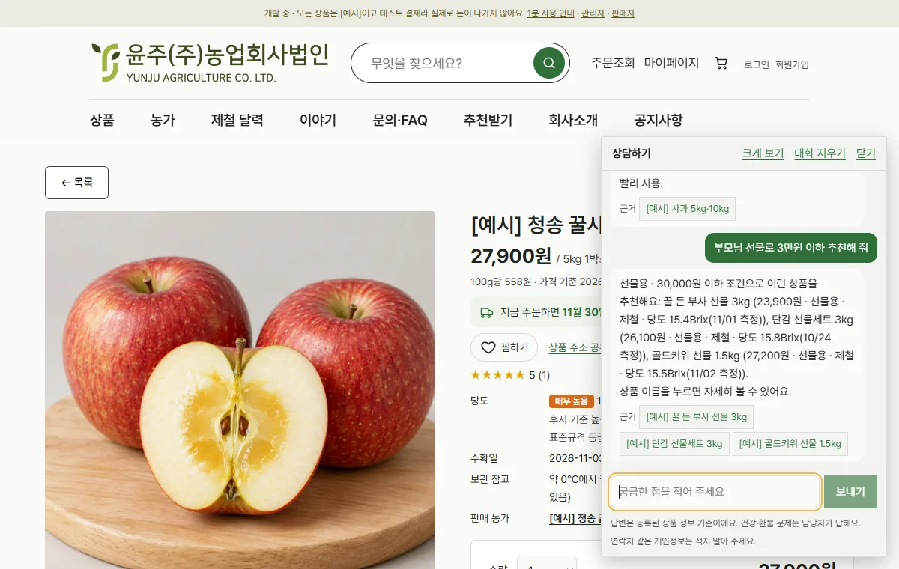 |
| 적는 동안 맞는 상품 6개가 바로 뜬다. 띄어쓰기를 무시하고(거창부사 = 거창 부사), '농축액'처럼 이름에 없는 말도 카테고리로 찾는다 | 보고 있는 상품을 알고 답한다. 답 아래에 근거 상품을 붙인다 |

### 상품 상세

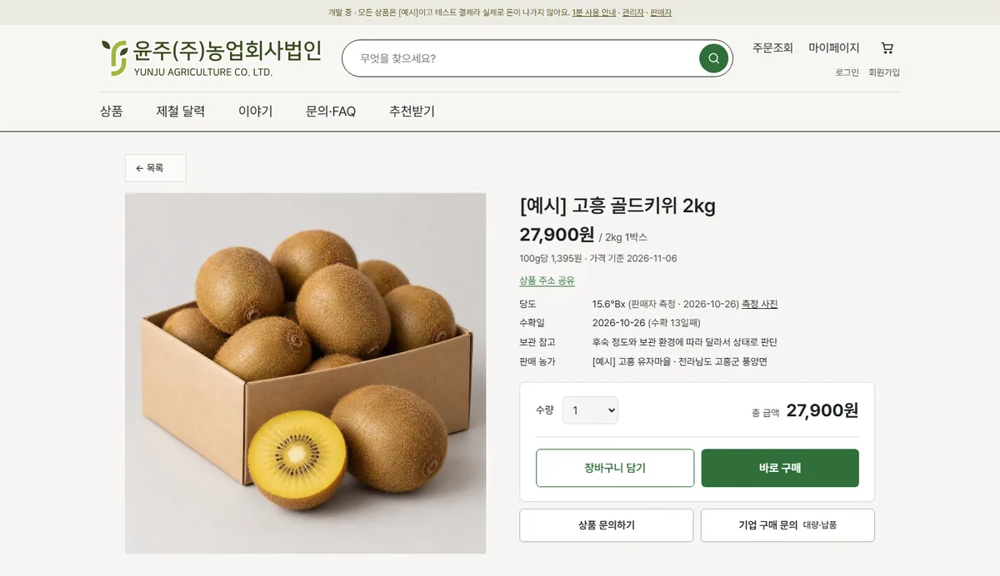

| 상품정보 제공 고시 | 레시피 | 상품 문의(Q&A) |
|---|---|---|
| 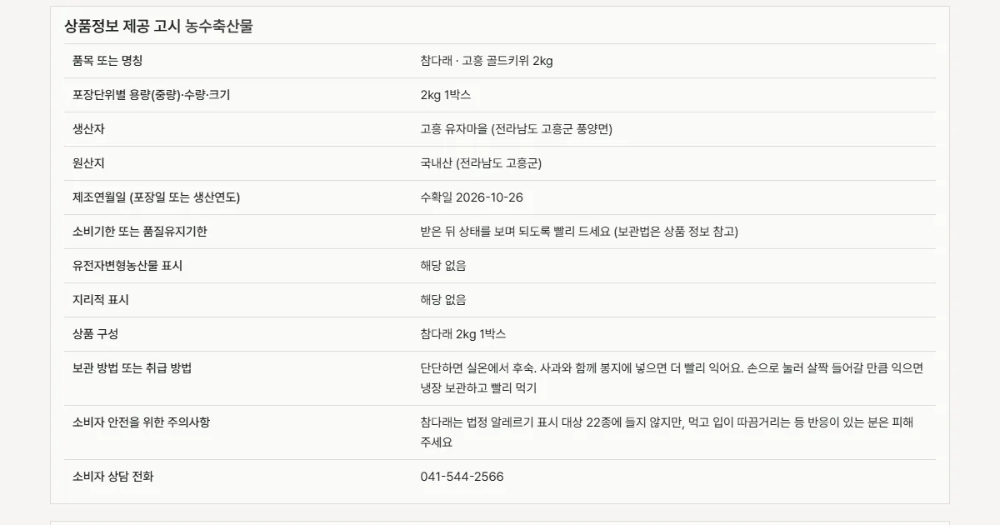 | 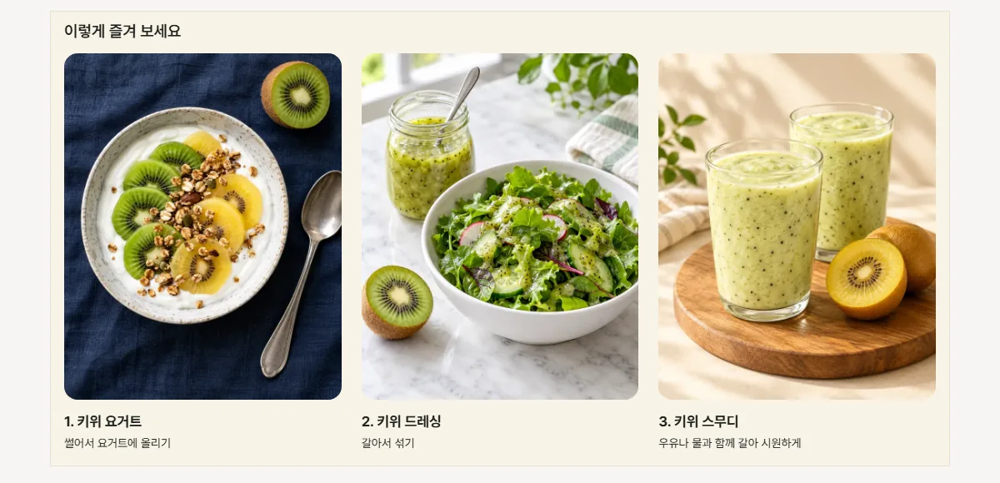 | 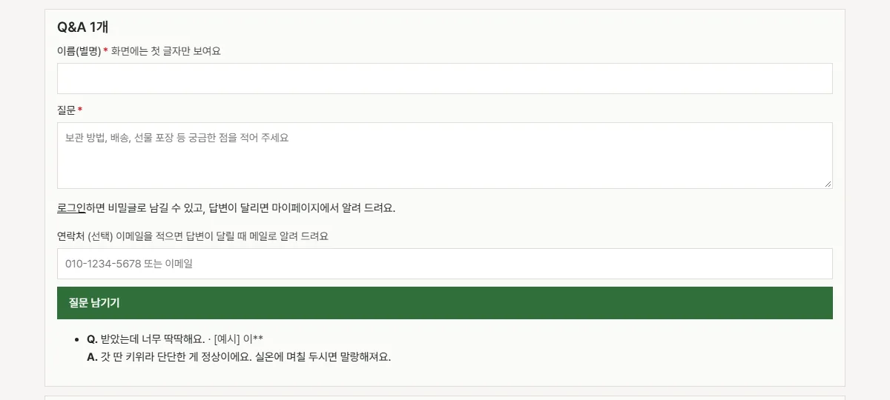 |

### 회원 · 장바구니 · 주문 조회

| 회원가입 (적는 동안 바로 안내) | 로그인 | 빈 장바구니 | 비회원 주문 조회 |
|---|---|---|---|
| 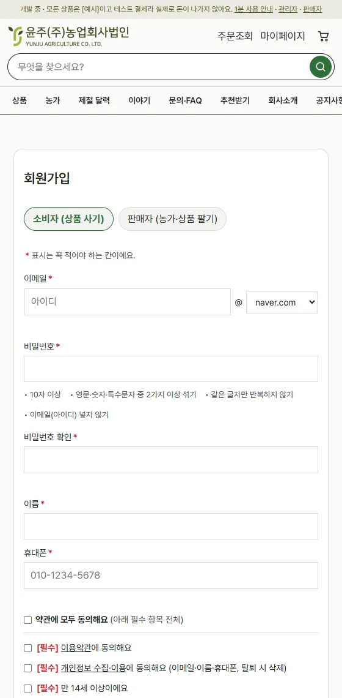 | 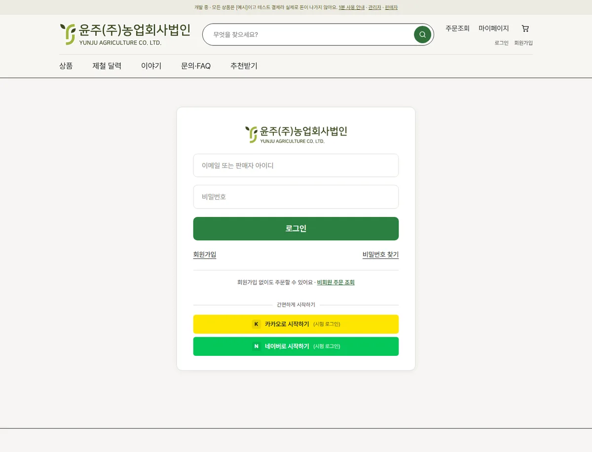 | 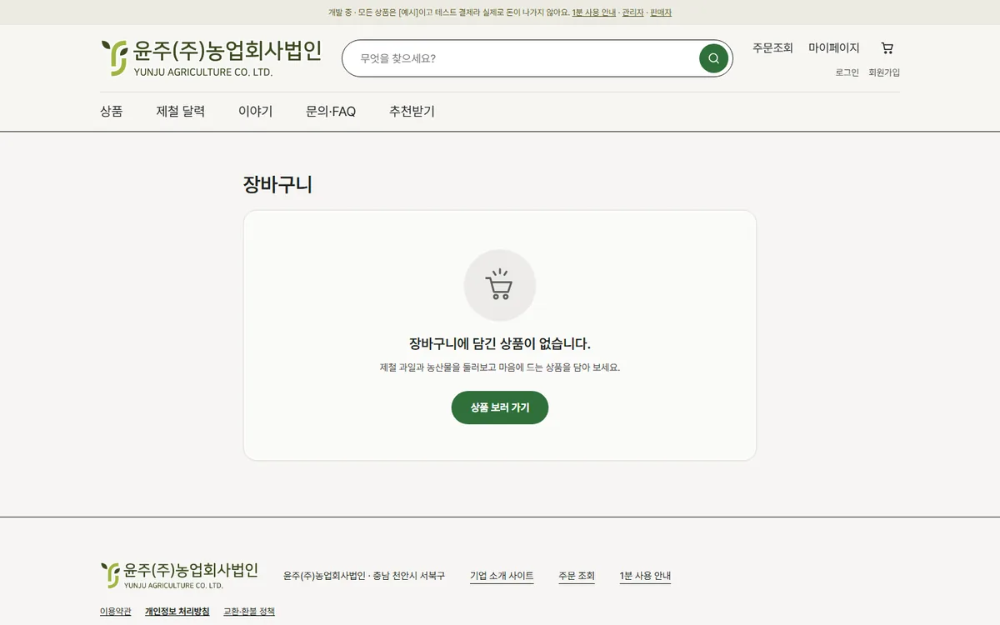 | 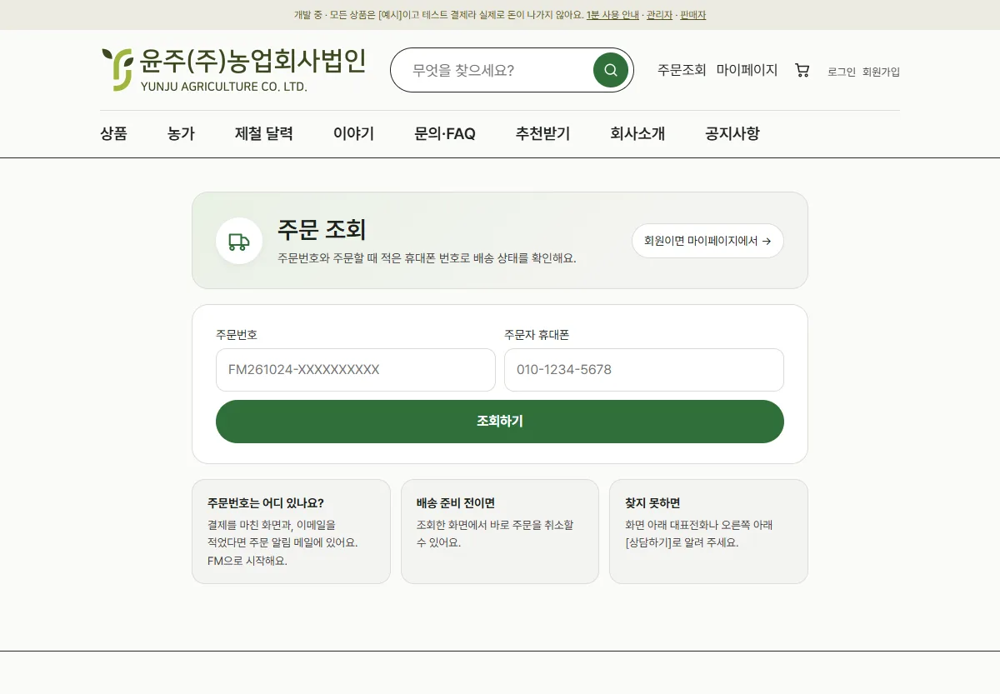 |

### 휴대폰

<p>
  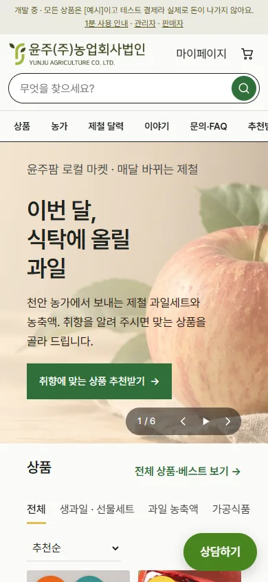
  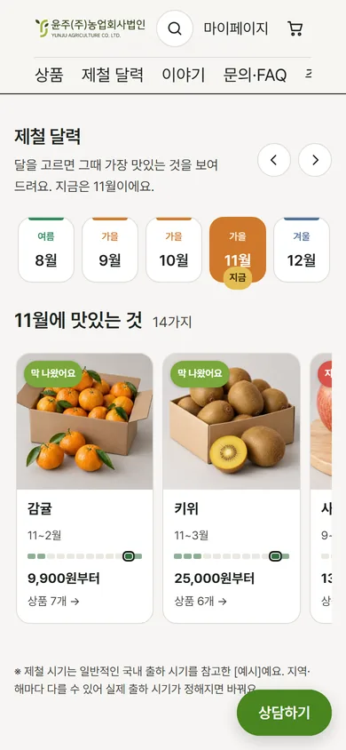
</p>

휴대폰에서는 헤더 검색이 돋보기 버튼이 되고, 제철 카드는 2장 조금 넘게 보이며 손가락으로 넘긴다.

> 사진은 `npm run demo` 화면을 헤드리스 브라우저로 찍었다(2026-11-07). 상품·레시피 사진은 시연용 AI 이미지라 실제 판매 전에 농가 실물 사진으로 바꾼다.

---

## 4. 누가 쓰나

| | 손님 | 판매 농가 | 회사 관리자 |
|---|---|---|---|
| 들어가는 곳 | `/` | `/seller` | `/admin` |
| 계정 | 없어도 됨 (회원·카카오·네이버 선택) | 판매자 가입 → 회사 승인 | 서버 명령어로만 만든다 (가입 화면으로 못 만듦) |
| 하는 일 | 둘러보기, 검색, 추천받기, 주문·결제, 주문 조회·취소·반품, 후기, 상품 문의, 재입고 알림, 상담 | 내 상품 등록·수정, 판매 옵션, 주문 배송 처리(송장), 내 몫 취소, 상품 문의 답변, 반품 의견, 농가 소개, 정산 확인 | 판매자·상품·품목 승인, 주문·배송·취소·환불, 문의함, 후기 관리, 상담 기록, 금지어, 매출, 접속 기록 |
| 볼 수 있는 범위 | 내 주문만 | **내 농가 것만** (다른 농가 것은 없는 것처럼 404) | 전부 |

---

## 5. 판매 농가가 들어와서 팔기까지

### 5-1. 전체 흐름

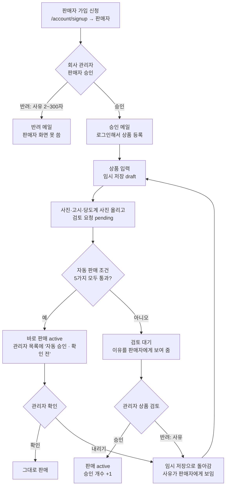

### 5-2. 판매자 가입 (농가가 하는 일)

`/account/signup`에서 **판매자 (농가·상품 팔기)** 를 고르고 아래를 적는다 (`server/sellers.js`).

| 칸 | 규칙 |
|---|---|
| 아이디 | 영문 소문자·숫자·밑줄 4~20자. `admin`·`root`·`manager`·`fourteam`으로 시작하면 안 된다. 아이디에 `@`가 없어서 하나뿐인 로그인 칸에서 손님(이메일)과 판매자(아이디)를 구분한다 |
| 비밀번호 | 10자 이상, 영문·숫자·특수문자 중 2가지 이상, 같은 글자만 반복 금지, 아이디가 들어가면 안 됨. 적는 동안 규칙마다 초록 체크가 켜지고, 확인 칸이 다르면 바로 빨간 테두리 |
| 농가·상호 이름 | 30자 안, 금지어(욕설·광고 등)가 있으면 안 됨 |
| 지역 · 대표자 이름 · 연락처 | 각각 30자·20자 안, 연락처는 0으로 시작하는 9~11자리 |
| 사업자등록번호 | 10자리. **이미 가입한 사업자번호면 다시 가입할 수 없다** (번호는 암호화하고, 같은지 비교는 찾기용 암호값으로) |
| 이메일 | 승인 결과를 받는다. 아이디를 적고 @ 뒤 주소를 고른다 (naver.com·gmail.com 등, 직접 입력 가능) |
| 약관 동의 | 이용약관·개인정보 수집 둘 다 필수 ('약관에 모두 동의해요'로 한 번에) |

- 같은 곳(IP)에서 **1시간에 5번**까지만 가입을 시도할 수 있다.
- 신청하면 판매자 상태는 `pending`(승인 대기)이고, 회사 관리자 이메일로 "판매자 가입 신청" 알림이 간다.
- 승인 전에도 로그인은 되지만, 판매자 화면의 기능(상품·주문·문의)은 **"판매자 승인 뒤에 쓸 수 있어요"** 로 막힌다.

### 5-3. 판매자 승인 (회사 관리자가 하는 일)

관리자 화면 **[판매자 승인]** 에 승인 대기 농가가 맨 위에 보인다. 대표자·연락처·사업자번호·이메일은 관리자만 본다.

- **[승인]** → 판매자 상태 `active`, 승인 시각을 남기고 "판매자 가입이 승인됐어요" 메일을 보낸다. 이제 상품을 올릴 수 있다.
- **[반려]** → 사유를 **2~300자**로 꼭 적는다(판매자에게 보임). 반려 메일을 보낸다.
- 이미 활동 중인 농가를 반려(활동 중지)하면 **그 농가의 모든 상품이 손님 화면에서 내려가** 임시 저장으로 돌아간다. 다시 승인돼도 상품은 다시 검토 요청해야 판매된다.
- 회사가 직접 파는 상품(회사 계정)은 이 승인 대상이 아니다.

### 5-4. 상품 등록 (농가가 하는 일)

판매자 센터 **[내 상품] → [새 상품]**. 판매자는 **기본 정보만** 적으면 나머지는 시스템이 채운다.

1. **품목 고르기** — 사과·감귤처럼 품목을 고르면 그 품목의 보관법·신선도 단계·먹으면 안 되는 신호·알레르기·레시피(식품팀이 만든 기준표)가 상품에 자동으로 붙는다. 목록에 없는 품목은 **새 품목 요청**을 하면 검수 대기 품목으로 생긴다(아래 5-6).
2. **기본 정보** — 상품 이름, 판매 단위(예: `5kg 1박스`), 가격, 재고. 상품 코드는 서버가 자동으로 만든다.
3. **판매 옵션(선택)** — 5kg·10kg처럼 옵션마다 이름·가격·재고를 따로 둔다. 옵션이 있으면 손님은 옵션을 골라야 산다. 상품 가격·재고는 판매 중 옵션의 최저가·재고 합으로 자동으로 맞춘다.
4. **당도·품종·수확일(과일)** — 당도를 적으면 **잰 날짜와 당도계 사진이 필수**다. 오늘보다 뒤 날짜, 수확 전에 잰 당도, 품목별 보통 범위를 벗어난 값은 막는다. 등급은 판매자가 고를 수 없고 서버가 공식 기준으로 정한다.
5. **상품정보 제공 고시** — 원산지·소비기한 같은 칸만 판매자가 적는다(품목·용량·생산자·보관법·상담 전화는 자동). 필수 칸이 비면 판매 요청·승인이 막힌다.
6. **AI로 상세 내용 채우기(선택)** — 품목·이름·단위·가격만 넣고 누르면 한 줄 소개·상세 설명·자주 묻는 질문 초안을 채운다. 상세페이지 패턴(이야기형·정보형·선물형·카페·업소형)을 고른다. 금지어나 **입력에 없는 숫자를 지어낸 문장은 빼고** 몇 개 뺐는지 알려 준다. 초안은 채워 주기만 하고, 판매자가 읽고 고쳐 저장해야 공개된다. 같은 사람 1시간에 20번까지.
7. **사진** — 대표 사진과 상세 사진(최대 8장). 올리면 1200px WebP와 400px 썸네일로 줄이고 **사진 속 위치 정보(EXIF)를 지운다**.
8. **출고 시작일(예약 판매, 선택)** — 오늘보다 뒤면 예약 상품이 된다(오늘부터 180일 안). 목록에 '예약 · 11월 20일부터'가 붙고 버튼이 [예약 구매]가 된다.
9. **[검토 요청]** — 여기서 자동 판매 여부가 정해진다.

### 5-5. 몇 번째부터 자동으로 판매되나 (자동 승인 규칙)

관리자가 한 명이라 모든 상품을 사람이 승인하면 판매가 늦어진다. 그래서 **믿을 만한 농가의 문제없는 상품은 바로 판매**하고, 위험한 것만 사람이 본다 (`server/sellers.js`의 `reviewReasons`).

**아래 5가지를 모두 통과하면 검토 요청 즉시 판매된다.** 하나라도 걸리면 검토 대기로 가고, 걸린 이유를 판매자 화면에 그대로 보여 준다.

| # | 조건 | 걸리면 보이는 이유 |
|---|---|---|
| 1 | 그 농가에서 **관리자가 승인한 상품이 3개 이상** (`TRUST_AFTER = 3`) | "처음 상품 3개는 회사가 확인해요 (지금까지 n개 승인)" |
| 2 | 상품의 품목이 **검수를 마친 품목** | "새 품목이라 검수가 필요해요" |
| 3 | 당도를 보여 주는 품목에 당도를 적었다면 **당도계 사진이 있음** | "당도계 사진이 없어요" |
| 4 | 그 농가에 **반려되거나 내려진 상품이 없음** | "반려되거나 내려진 상품이 있어요" |
| 5 | 그 농가 상품 후기의 **'표시와 달랐어요'가 3개 미만** | "'표시와 달랐어요' 후기가 n개 있어요" |

- 즉, 새 농가는 **처음 3개 상품은 반드시 관리자가 승인**하고, 3개가 승인된 뒤 올리는 **4번째 상품부터** 나머지 조건만 맞으면 자동으로 판매된다.
- 승인 개수는 관리자가 직접 [승인]한 상품만 센다. 자동 승인된 상품은 세지 않는다.
- 관리자가 상품을 반려하거나 내리면 그 농가는 조건 4에 걸려 **자동 판매가 멈춘다**. 그 상품을 고쳐 다시 승인받으면 풀린다.
- 자동으로 판매된 상품은 관리자 상품 목록에 **'자동 승인 · 확인 전'** 으로 남는다. 관리자는 나중에 **[확인]** 하거나 **[내리기]** 한다.
- 이미 판매 중인 상품의 가격·재고 수정은 바로 반영된다. 대신 가격·당도·수확일·원산지·소비기한을 바꾸면 **누가 언제 바꿨는지 수정 이력**에 남고, 당도나 품종을 바꾸면 옛 당도계 사진은 내려간다(새 값의 증거가 아니라서).

### 5-6. 새 품목 검수

농가가 목록에 없는 품목(예: 수박)을 요청하면 품목이 `pending`(검수 대기)으로 생긴다. 공식 당도 규격이 있는 품목은 기준이 바로 붙는다. 관리자 **[품목 검수]** 에서 보관·안전 정보의 출처를 확인하고 검수해야 손님 화면과 상담에 그 정보가 나온다. 그전까지 그 품목 상품은 자동 판매되지 않는다(조건 2).

**품목 검수와 상품 판매는 따로다.** 품목 검수 전이라도 관리자가 그 상품을 [승인]하면 상품은 화면에 올라간다. 대신 품목 정보만 숨긴다 (`server/items.js`의 `publicItem`).

| 품목 검수 전에 판매 중인 상품의 상세 화면 | 보이나 |
|---|---|
| 상품 이름 · 사진 · 가격 · 설명 · 구매 | 보인다 |
| 보관법 · 먹으면 안 되는 신호 · 레시피 · 알레르기 · 당도 등급 | 숨긴다 → "새로 들어온 품목이라 담당자가 보관·섭취 정보를 확인하고 있어요. 궁금한 점은 아래 상품 Q&A로 물어봐 주세요." |
| 상담 챗봇 | 그 품목의 보관·레시피를 물으면 "담당자가 아직 확인하고 있어요"라고 답하고 지어내지 않는다 |

AI 초안의 보관·안전 정보가 사람 확인 없이 손님에게 나가지 않게 하면서, 상품 판매는 품목 검수 때문에 늦어지지 않게 하려고 나눴다. 관리자가 품목을 검수 완료하면 레시피(사진 포함)·보관법이 그 품목의 모든 상품에 바로 보인다.

**새 농가가 새 품목(예: 수박) 상품을 올리면** — 가입부터 판매까지:

1. **판매자 가입 → [판매자 승인]** (5-2, 5-3). 운영처럼 2단계 인증이 필수면, 처음 로그인할 때 로그인 화면에서 인증 앱을 등록한다(서버 명령어 불필요)
2. **상품 등록 중 [목록에 없는 품목 요청]** → 품목이 `pending`으로 생긴다. [AI로 채우기]를 누르면 상품 설명과 함께 그 품목의 보관법·먹으면 안 되는 신호·레시피 초안이 품목에 들어가고, Cloudflare 키가 있으면 레시피 사진도 뒤에서 만들어진다
3. **[검토 요청]** → 새 농가라 조건 1(처음 3개)과 새 품목이라 조건 2에 **둘 다 걸려 검토 대기**. 판매자 화면에 두 이유가 그대로 보인다
4. **관리자가 할 일 두 가지 (순서는 상관없음, 권장은 품목 먼저)**
   - [품목 검수]: AI 초안을 출처(농사로·식품안전나라 등)와 대조해 고치고, 레시피 사진을 확인하고 [검수 완료]
   - [상품 관리]: 상품을 확인하고 [승인] → 화면에 올라간다. 이 승인이 그 농가의 승인 개수(3개)에 들어간다
   - 상품을 먼저 승인하면 품목 검수 전까지는 위 표처럼 품목 정보 없이 판매된다
5. **그 뒤:** 그 농가가 승인 3개를 채우면 4번째 상품부터는 자동 판매된다. 다만 **품목이 아직 검수 전이면 그 품목 상품은 계속 검토 대기**(조건 2). 품목이 검수되면 다른 농가가 같은 품목으로 올리는 상품도 조건 2에 걸리지 않는다
6. 같은 이름의 품목을 다른 농가가 또 요청하면 새로 만들지 않고 이미 있는 품목을 쓴다(검수도 한 번이면 된다)

**레시피와 카드 사진 (2026-11-08)**: [품목 검수]에서 레시피를 한 칸씩 고치고, 레시피마다 카드 사진을 붙인다. 코드나 파일 주소를 몰라도 된다.

- **[AI로 빈 칸 채우기]**: 비어 있는 보관법·먹으면 안 되는 신호·레시피 3개의 초안을 채운다. 이미 적힌 칸은 바꾸지 않는다. 레시피가 새로 생기면 **사진도 이어서 만든다**(아래 키가 있을 때). 초안은 화면에만 채워지고 관리자가 [저장]해야 반영된다
- 판매자가 상품 등록 중 [AI로 채우기]로 새 품목의 레시피를 채워도, 서버가 뒤에서 레시피마다 사진을 만들어 붙인다
- 레시피마다 **[사진 올리기]**(jpg·png·webp 2MB 이하 → 720×900 WebP, 위치 정보 삭제) · **[AI로 사진 만들기]** · [사진 빼기]. 사진이 없으면 손님 화면은 요리 종류별 기본 그림
- AI 사진은 Cloudflare Workers AI(FLUX.1 schnell, `server/imagegen.js`). `.env`에 `CLOUDFLARE_ACCOUNT_ID`·`CLOUDFLARE_AI_TOKEN`이 없으면 버튼이 숨고 올리기만 된다. 하루 장 수 상한 `IMAGE_DAILY_LIMIT`(기본 30), 관리자 1명당 1시간 30장

### 5-7. 상품 검토 (회사 관리자가 하는 일)

관리자 **[상품 관리]** 에서 '검토 대기'가 맨 위에 온다.

- **[승인]** → 판매 시작. 당도를 적은 판매자 상품은 **당도계 사진이 없으면 승인할 수 없고**, 고시 필수 칸이 비어도 승인되지 않는다.
- **[반려]** → 사유를 적으면 임시 저장으로 돌아가고 판매자에게 사유가 보인다. 그 농가의 자동 판매가 멈춘다.
- 목록에는 사진·상태 칩(판매 중·검토 대기·반려·품절)과 '당도 사진 없음', '표시와 다름 후기 n', '수정 이력 n' 표시가 붙는다.

### 5-8. 주문이 오면 (판매 농가가 하는 일)

- **[오늘 할 일]** 숫자 카드: 준비할 주문, 보낼 주문, 답할 문의, 반품, 반려된 상품.
- **[주문]**: 내 농가 상품이 든 주문만 보인다. 여러 농가 상품이 섞인 주문도 **내 몫만 내가** 보낸다(농가마다 택배·배송비·송장이 따로). 받는 분 정보는 내가 보내기 전까지만 보이고, 주문번호는 `FM261107-······AWW6`처럼 가려서 보인다.
- 배송 준비 → 택배사·송장 입력 → 배송 중. 아직 보내기 전이면 **[내 농가 몫 취소]**(사유 필수, 손님에게 보임)로 내 몫만 돌려줄 수 있다.
- **[상품 문의]**: 내 상품에 달린 질문에 답한다(비밀글 포함). 손님 연락처는 회사만 본다.
- **[반품]**: 내 농가 반품 신청을 보고 의견을 남긴다. 승인·환불은 회사가 한다.
- **정산**: 배송 완료 7일 뒤(또는 손님이 먼저) **구매 확정**된 내 상품 매출 + 내 배송비가 정산 대상. 취소한 내 몫은 빠지고 반품 환불액은 뺀다.

---

## 6. 손님이 사고 받기까지

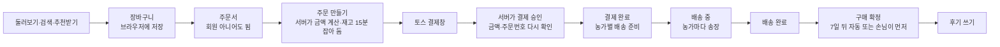

1. **둘러보기** — 카테고리·정렬(추천·인기·당도 등급·신상품·별점·가격), 헤더 검색, 제철 달력, [취향에 맞는 상품 추천받기](질문 몇 개에 답하면 태그 점수로 고르고 이유를 보여 줌).
2. **장바구니** — 브라우저에 저장된다. 담으면 아래에 알림이 뜨고 **농가별로 "N원 더 담으면 무료 배송"** 게이지를 보여 준다. 옵션마다 20개, 주문당 60개까지.
3. **배송비** — 농가마다 따로 계산한다. 기본 배송비 3,000원, 그 농가 상품이 50,000원 이상이면 그 농가는 무료 `[예시]`.
4. **주문 만들기** — 금액은 브라우저가 보낸 값이 아니라 **서버가 DB 가격으로 다시 계산**한다. 재고는 충분할 때만 줄이고(동시에 사도 초과 판매 없음), 결제하지 않고 **15분**이 지나거나 결제창에서 취소하면 돌려놓는다.
5. **결제** — 카드 정보는 토스 결제창이 받고 우리 서버에는 오지 않는다. 결제창에서 돌아온 금액이 주문 금액과 다르면 승인하지 않는다. 같은 주문을 여러 번 승인 요청해도 한 번만 처리한다(DB 잠금 + 멱등키). 통신이 끊기면 실패로 단정하지 않고 토스 결제 조회로 실제 상태를 확인한다. 지금은 카드·간편결제·계좌이체만 받는다.
6. **배송** — 농가마다 따로 보내고, 주문 상세에 농가별 상태·송장·배송 조회 링크가 보인다. 예약 상품은 약속한 출고일에 보낸다.
7. **주문 조회** — 회원은 마이페이지, 비회원은 [주문조회]에서 **주문번호 + 주문자 휴대폰 번호**(10분에 10번까지). 결제 완료 상태면 손님이 바로 취소할 수 있다.
8. **구매 확정** — 배송 완료 **7일 뒤 자동**(5분마다 확인), 또는 손님이 [지금 구매 확정하기].
9. **후기** — 그 상품을 보낸 농가의 배송이 끝나면 주문·상품마다 한 번 쓴다. 별점과 **"상품 페이지 정보와 맞았나요?"** 를 묻는다. 같은 곳에서 1시간에 10번까지.

---

## 7. 취소 · 반품 · 환불

**돈이 나가는 일은 모두 사람이 누른다.** 반품 신청만으로는 돈이 나가지 않고, 자동 환불은 없다.

| 상황 | 누가 | 어떻게 |
|---|---|---|
| 결제 완료, 아직 아무도 안 보냄 | 손님 | 주문 조회·마이페이지에서 바로 전체 취소 → 결제 취소·재고 복구 |
| 배송 준비 중까지 | 관리자 | 전체 취소(전액 환불) |
| 여러 농가 중 아직 안 보낸 농가 몫만 | 관리자·그 농가 | **농가별 부분 취소**: 그 농가 상품 금액 + 배송비를 토스 부분 취소로 돌려주고 그 농가 재고를 돌려놓는다. 이미 보낸 농가는 취소 불가 → 받은 뒤 반품 |
| 받은 뒤 | 손님 → 관리자 | **반품 신청** → 관리자 승인/거절(사유 보임) → 상품 확인 → 관리자가 금액을 넣고 환불 |

- **반품 기간**: 단순 변심은 받은 날부터 **7일**, 상품 하자·표시와 다름·오배송은 **3개월**. 받은 날 = 그 농가 배송이 배송 완료가 된 날(한국 날짜).
- **환불 한도**(서버가 계산, 이보다 많이 못 돌려줌)
  - 단순 변심: 돌려보낼 상품 금액 − 돌려보내는 배송비 − (처음 배송이 무료였다면) 보낼 때 배송비. 왕복 배송비는 손님 부담.
  - 하자·오배송: 돌려보낼 상품 금액 + 그 농가 배송에 낸 배송비. 판매자 부담.
  - 어느 경우든 그 농가 배송에 낸 돈, 주문 결제 금액에서 **이미 돌려준 돈을 뺀 만큼**을 넘지 못한다.
- 반품 상품 재고는 돌려놓지 않는다(신선식품은 다시 팔 수 있는지 사람이 봐야 해서).
- **돈이 어긋나지 않게**: 토스 취소 한 번이 기록 한 줄(`order_refunds`: 누가·언제·얼마). 주문을 잠근 상태에서 누적액이 결제 금액을 넘는지 보고, 토스에 보내기 **전에** '보냄(결과 모름)' 기록을 먼저 남긴다. 같은 요청이 두 번 와도 같은 멱등키라 한 번만 취소된다. 결과를 모르면 "결과 확인 중"으로 두고 그동안 그 주문의 다른 취소·환불·배송 시작을 막는다.
- 정책 글(교환·환불 정책)과 코드 값은 같은 곳(`server/policy.js`의 `RETURNS`)에서 나온다.

---

## 8. 기능 하나하나

### 회사 소개 · 공지사항 · 언론보도 (회사 홈페이지 기능, 2026-11-08)

회사 홈페이지(yunjufarm.co.kr)에 있던 기능을 쇼핑몰 안으로 옮겼다. 헤더 메뉴에 '회사소개'·'공지사항', 화면 아래에 회사 소개·공지사항·언론보도·오시는 길·사이트맵·이메일무단수집거부.

- **회사 소개 `/about`**: 회사소개(두 가지 약속), 핵심 가치 7가지, 로컬푸드(무엇·왜 중요한가·5가지 키워드), 만드는 것, 오시는 길(주소·전화·이메일·업무시간 + 네이버·카카오·구글 지도 링크). 홈페이지에서 그림 속 글이던 내용은 화면 글로 옮겼다(화면 낭독기·휴대폰에서 읽히게). 글은 `src/shop/home/content.js`의 `ABOUT`
- **공지사항 `/notice` · 언론보도 `/press`** (`server/posts.js`): 목록(사진·요약·날짜, 10개씩), 상세(본문·사진·링크, 이전·다음 글). 홈페이지의 공지 5건과 언론보도 2건(기사 링크)을 옮겨 두었다
  - 관리자 **[공지·언론]**: 글 쓰기·고치기·지우기, 목록 맨 위 고정, 손님에게 숨기기, **첫 화면 팝업**(공지만, 끝나는 날까지, 손님은 '오늘 하루 보지 않기')
  - 본문은 글자 그대로(줄바꿈만) 보여 준다. HTML을 받지 않아 글에 스크립트를 넣을 수 없고, 링크는 `https://` 주소만, 사진은 이 사이트의 `/posts/` 파일만 받는다
- **사이트맵 `/sitemap`**, **이메일무단수집거부 `/policy/noemail`**
- 홈페이지의 **경영공시**는 시험 글뿐이고 **함께하는 사람들**은 준비 중이라 옮기지 않았다

### 홈페이지 관리 (관리자, 2026-11-08)

관리자는 관리자 화면만이 아니라 홈페이지 자체도 보고 고친다.

- **관리자 막대**: 관리자로 로그인한 채 쇼핑몰을 열면 맨 위에 막대가 뜬다 → [관리자 화면] · [홈페이지 관리] · [공지·언론], 상품 화면에서는 **[이 상품 고치기]**(그 상품 수정 화면이 바로 열림). 판매자로 로그인했으면 [판매자 센터로]. 관리자 화면 위쪽의 [홈페이지 보기]로 언제든 쇼핑몰로 간다
- **관리자 [홈페이지 관리]** (`server/siteContent.js`, `src/admin/SiteContent.jsx`): 첫 화면의 **큰 배너**(작은 제목·큰 제목 3줄·소개 글·버튼 글·사진 1~8장과 넘어가는 간격), **이야기 배너**(1~5장: 제목·글·사진·버튼 2개), **제철 달력**(품목·찾을 말·제철 달), **자주 묻는 질문**(1~20개)을 코드 없이 고친다. 사진은 그 자리에서 올린다(jpg·png·webp 2MB 이하 → 긴 변 2400px WebP, 사진 속 위치 정보 삭제)
- 저장한 칸만 DB(`site_content`)에 두고, 없으면 `src/shop/home/content.js`의 기본값을 쓴다. [기본값으로]를 누르면 처음 내용으로 돌아간다. 손님 화면에는 30초 안에 바뀐다
- 지키는 것: 관리자만 고칠 수 있다(판매자·손님은 401/403). 글은 글자 그대로 보여 준다. 사진은 이 사이트 안의 사진이나 여기서 올린 사진만, 버튼 주소는 `#칸이름`·`/주소`·`https://`만 받는다(`javascript:` 같은 주소는 막힘). 관리자 막대용 확인(`/api/staff`)은 손님 방문마다 부르므로 관리자 접속 기록에 남기지 않는다
- **회사 소개(`/about`)** 도 [홈페이지 관리 → 회사 소개]에서 고친다: 맨 위 글·사진, 약속, 핵심 가치(제목의 `{개수}`는 목록 개수로), 로컬푸드 글·사진·질문·키워드, 만드는 것(사진·주소). 오시는 길(주소·전화)은 사업자 정보 값

### 쇼핑몰 설정 (관리자, 2026-11-08)

관리자 **[쇼핑몰 설정]** (`server/settings.js`, `src/admin/Settings.jsx`)에서 코드 없이 고친다. 저장한 칸만 DB(`shop_settings`)에 두고, 없으면 `server/policy.js`의 기본값을 쓴다.

- **사업자 정보**: 쇼핑몰·회사 이름, 대표자, 사업자등록번호, 통신판매업 신고번호, 주소, 대표전화, 이메일, 업무 시간, 개인정보 보호책임자. 손님 화면 아래쪽, 상품 정보 고시의 상담 전화, 회사 소개의 오시는 길, 알림 메일 제목, 상담 답에 쓰인다
- **배송**: 기본 배송비, 무료 배송 기준, 택배사, 출고 안내. 저장한 뒤 들어오는 주문부터 바로 이 값으로 계산한다
- **반품 기간**: 단순 변심 일수, 하자 개월수, 하자를 안 날부터 일수. 법정 최소(7일·3개월·30일)보다 짧게는 저장되지 않는다
- **약관·정책 글**: 교환·환불 정책, 이용약관, 개인정보 처리방침, 이메일무단수집거부의 항목을 고치고 순서를 바꾼다. 글의 `{배송비}`·`{변심기간}`·`{전화}` 같은 자리표시는 위 설정 값으로 채워져서, 배송비를 바꾸면 정책 글도 함께 바뀐다
- 저장하면 서버가 바로 새 값을 쓰고(다시 켤 필요 없음), 상품 캐시를 비우고, 상담 자료(배송비·연락처·환불 정책)도 다시 만든다. [기본값으로]로 처음 값으로 돌아간다

### 관리자 계정 (관리자, 2026-11-08)

서버 명령어(`npm run create-admin`, `npm run admin-2fa`) 없이 관리자 **[관리자 계정]** (`server/staff.js`, `src/admin/Staff.jsx`)에서 한다. 명령어는 첫 관리자를 만들 때만 필요하다.

- **내 계정**: 비밀번호 바꾸기, 2단계 인증(인증 앱) 등록·다시 등록·해제(필수인 서버에서는 해제 불가)
- **다른 관리자**: 목록(만든 날·2단계 인증·마지막 로그인), 비밀번호 다시 정하기, 2단계 인증 풀기(휴대폰 분실), 지우기(내 계정·마지막 관리자는 못 지움)
- **관리자 추가**: 아이디와 처음 비밀번호. 새 관리자에게 직접 전하고, 로그인한 뒤 바꾸게 한다
- 계정에 손대는 일은 모두 **내 비밀번호를 한 번 더** 받는다(틀리면 로그인과 같은 잠금). 비밀번호는 10자 이상·영문·숫자·기호 중 두 가지 이상·아이디 넣지 않기
- 비밀번호·2단계 인증이 바뀐 계정은 이미 로그인한 곳도 바로 끊긴다(`session_version`). 내 것을 바꾸면 이 브라우저는 새 쿠키로 이어 간다
- **처음 로그인 때 2단계 인증 등록**: 2단계 인증이 필수(운영 기본)인데 아직 등록하지 않은 관리자·판매자는, 비밀번호가 맞으면 로그인 화면에 등록 키가 나온다. 인증 앱 코드를 넣어야 로그인된다(10분 안에, `/api/admin/2fa-first`). 예전에는 서버 명령어가 필요했다
- 한 일은 [접속 기록]에 남는다(`staff_add`, `password_change`, `2fa_on` 등)

### 회사 실제 제품 (`npm run company-content`)

회사 홈페이지의 제품 11개를 회사 직영 상품으로 넣었다 (`data/company_content.json`, 사진은 `public/product-photos/yj_*`).

- **프리미엄 과일 농축액 베이스 7종** (1.9kg): 복숭아·자몽·유자·레몬·패션후르츠(윤주톡톡), 청포도, 딸기. 품목 '과일 농축액 베이스'라 '과일 농축액' 카테고리에 들어간다
- **로컬 과일세트 4종**: 천안 성환 배 세트(5·7.5·15kg 옵션), 과일 혼합 세트, 명품 사과세트(3·5kg), 도라지 배즙 세트(25·50·100포)
- 설명과 사진은 회사 홈페이지 그대로다. 상세페이지 이미지(세로로 긴 이미지)는 상품의 **[상세 정보]** 칸에 이어서 보여 준다(`products.detail_images`)
- **상품정보 제공 고시**: 복숭아·자몽·유자·레몬·패션후르츠 5종은 상세 이미지의 라벨(식품 유형 음료베이스, 원재료와 함량, 영양성분, 소비기한 제조일로부터 18개월, 품목보고번호)을 그대로 옮겼다. 제조원은 쏘울코리아팜(주)이고 윤주(주)는 판매원이다
- **회사 확인이 필요한 것**: 가격·재고(모두 [예시]), 청포도·딸기 베이스와 과일세트·배즙의 라벨 정보, 제조원 소재지. 고시 칸에 '회사 확인 필요'로 적어 두었다
- 품목 '과일 농축액 베이스'는 **검수 전**이라 상품 화면의 보관·섭취 안내가 가려져 있다. 관리자 [품목 검수]에서 라벨 출처를 확인하고 검수하면 보인다
- 다시 실행해도 같다: 처음에만 가격·재고·옵션을 넣고, 다음부터는 글·사진·고시만 바꾼다(관리자가 고친 가격·재고는 그대로)

### 검색 (`server/search.js`)
- **띄어쓰기 무시**: '거창부사' = '거창 부사', '설향딸기' = '설향 딸기'.
- **다른 말도 같은 뜻으로**: 쥬스·주스 → 즙, 샤인머스켓 → 샤인머스캣, 귤·밀감 → 감귤, 키위 ↔ 참다래, 고추가루 → 고춧가루, 절인배추 → 절임배추, 대용량 → 업소용, 흠과·파지 ↔ 못난이, 키로 → kg 등.
- **카테고리 말**: '농축액·원액·베이스' → 과일 농축액(유자청·매실청), '채소·야채', '과일', '가공품'.
- **모두 맞는 상품이 없으면** 하나라도 맞는 상품을 "비슷한 상품"으로 안내한다.
- 검색어는 단어 5개·단어당 20자, 바꿔 찾는 말 32개까지(긴 검색어로 서버를 멈추지 못하게). 손님이 보낸 글자는 SQL 값으로만 넘긴다.

### 제철 달력
- 계절 색(봄·여름·가을·겨울) 달 띠에서 달을 고르면 그 달 제철 품목 카드가 나온다. 이번 달에는 '지금' 표시.
- 카드: 대표 상품 사진, **막 나왔어요 / 지금 한창 / 끝물 / 이달만**, 가장 싼 값, 상품 수, 열두 달 제철 막대, 품절이면 '지금은 품절'. 누르면 그 품목 상품을 찾는다.
- 사진·가격·상품 수는 실제 판매 중 상품에서 가져온다(`/api/season-items`, 60초 캐시). 품목별 제철 달은 일반적인 국내 출하 시기를 참고한 `[예시]`(`src/shop/home/content.js`의 `SEASON`).

### 상품 상세
- 이름·가격·100g당 가격·가격 기준일·당도(판매자 측정 · 측정 사진)·수확일·보관 참고·판매 농가가 사진 바로 옆에.
- **상품정보 제공 고시** 표(공정위 고시의 농수축산물·가공식품 항목), **보관 방법과 먹으면 안 되는 신호**(출처 표시), **레시피 카드**(사진형), 판매 농가 이야기, 구매 후기, 상품 문의, 함께 보면 좋은 상품.
- [기업 구매 문의]: 회사·담당자·연락처·희망 수량·요청사항, 개인정보 동의 필수 → 관리자 문의함에서 접수 → 확인 → 완료.

### 당도 등급과 거짓 표시 막기 (`server/brix.js`)
- 농산물 표준규격의 품종별 당도 규격을 그대로 쓴다. 특 이상 '특', 상 이상 '상', 그 아래는 측정값만. 기준이 없는 품목은 측정값만.
- 당도계 사진이 없거나, 당도·품종을 바꾼 뒤 사진을 다시 안 올렸거나, 후기 이의가 많으면 **등급을 붙이지 않는다**.
- 후기의 '표시와 달랐어요'가 3개 이상이고 답한 사람의 절반 이상이면 **목록·상세·상담·추천에서 당도 표시를 내린다**.
- 약관에 상품 정보 표시 책임은 판매 농가에 있다고 적었다.

### 상품 문의(Q&A)와 비밀글
- 이름(별명)과 질문(5~500자) 필수, 공개 화면에는 이름 첫 글자만(김**). 연락처는 선택이고 남기면 개인정보 동의가 필요하며 관리자만 본다. 같은 곳에서 10분에 5번, 같은 상품에 똑같은 질문은 한 번만.
- **비밀글은 로그인한 회원만** 쓸 수 있다. 공개 목록에는 '비밀글'과 답변 여부만 보이고, 내용은 쓴 회원·그 농가·관리자만 본다. 비밀글은 상담 챗봇·벡터 검색 자료에서 빠진다.
- **답변 알림**: 답이 달리면 헤더 '마이페이지' 옆에 숫자가 뜨고, 마이페이지 [내 문의]에서 본다. 연락처에 이메일을 적었으면 메일을 한 번 보낸다(답변 내용은 넣지 않고 상품 주소만).

### 재입고 알림 (`server/restock.js`)
- 품절 상품·옵션에 이메일을 남긴다(동의 필수, 10분에 10번). 같은 이메일로 다시 신청해도 같은 답을 준다(신청 여부를 알아내지 못하게).
- 신청하면 **확인 메일**이 가고, 메일의 링크에서 **[취소하기]를 눌러야** 취소된다(메일 보안 프로그램이 링크를 미리 열어도 저절로 취소되지 않게). 취소하면 이메일을 바로 지운다.
- 다시 들어오면 한 번만 알린다(재고를 바꾼 직후와 5분 정리 때). 메일함에 넣지 못하면 다음 정리 때 다시 보낸다. 이메일은 암호화하고, 보낸 뒤 30일·못 보내면 180일 뒤 지운다.

### 상담 챗봇 (`server/chat.js`)

AI는 마지막 수단이다. 질문이 오면 이 순서로 처리하고, 1~5단계는 AI를 부르지 않는다(토큰 0).

1. **정해진 답으로 넘김** — 건강(당뇨·임신·아기 등), 환불·교환·배송 사고, 대량 구매, 주문 조회, 배송비.
2. **DB 값으로 바로 답** — 가격·재고·옵션별 가격·박스당 개수·당도·출고일, 추천.
3. **품목 정보로 문장 만들기** — 보관법·개봉 후·언제까지·레시피·먹어도 되나(먹으면 안 되는 신호 + 담당자 안내)·알레르기·산지·수확일·상품 비교.
4. **비슷한 질문 다시 쓰기** — 담당자가 답한 Q&A와 상품 FAQ를 글자 비교·벡터 검색으로 찾는다.
5. **못 찾으면** — 고를 수 있는 질문 버튼 + 상품 Q&A 안내. 상품과 관련 있으면 [AI에게 물어보기] 버튼.
6. **AI 답변(손님이 버튼을 누를 때만)** — 그 품목의 상품·기준표·Q&A를 [자료]로 준다. 비회원 10분에 3번, 회원 10분에 10번, 하루 전체 `AI_DAILY_LIMIT`(기본 40, 0이면 끔).
7. **답 검사** — 자료에 없는 가격·당도, 효능 표현, "먹어도 돼요", 환불 약속, 영어·한자 섞임이 있으면 다른 모델로 한 번 다시 묻고, 그래도 걸리면 "상품 Q&A에 남겨 주세요"로 넘긴다.
8. **기록** — 모든 질문과 답은 관리자 [상담 기록]에. 맨 위 '답 못 한 질문'을 많은 순으로 묶어 보여 줘서, 그 순서대로 품목 정보·Q&A를 채우면 AI 호출이 가장 많이 준다.

- 상담 창은 같은 곳에서 10분에 15번까지. 상담 내용은 이 브라우저에 24시간 기억하고 **로그인·로그아웃·탈퇴하면 지운다**(공용 PC에서 앞사람 대화가 남지 않게). [대화 지우기] 버튼도 있다.
- 주민등록번호·카드번호를 적으면 처리·기록하지 않고 거절하고, 전화번호·이메일은 AI로 보내거나 기록하기 전에 가린다.
- 평가: `npm run chat-eval` — 질문 348개(팀 질문·AI 변형·팀 밖 질문)를 **정답 / 자신 있게 틀림 / 모른다고 넘김**으로 나눠 센다. 최근 결과 정답 240, 자신 있게 틀림 0 → [docs/chat_eval_report.md](docs/chat_eval_report.md)
- 상담 규칙은 식품팀·기획팀이 고칠 수 있는 `server/chat_rules.md`에 있다(저장하면 바로 반영).

### 추천 (`server/recommend.js`)
- 상품 태그(`data/tags.csv`)로 점수: 고른 조건에 맞는 태그 수 → 제철 → 당도 측정 → 싼 순. 품절은 빼고 **왜 골랐는지**(맞은 태그·당도)를 보여 준다.
- 질문형 추천(태그 묶음마다 질문 하나, 새 태그는 자동으로 선택지에), 이번 주 추천, 함께 보면 좋은 상품(같은 품목 → 태그 2개 이상 겹침).
- 상담에서 "부모님 선물로 달달한 거"처럼 물으면 말에서 조건을 찾아 같은 규칙으로 고른다. **AI가 상품을 지어낼 수 없다.**

### 회원
- 이메일 회원가입(적는 동안 이메일·비밀번호·휴대폰 규칙을 바로 알려 주고, 필수 칸은 빨간 별표), 카카오·네이버 간편 로그인.
- 로그인 쿠키 14일. 비밀번호를 바꾸거나 탈퇴하면 다른 기기의 로그인도 끊긴다. 로그인을 5번 틀리면 10분 잠금.
- 비밀번호 찾기: 가입 여부와 관계없이 같은 답, 링크는 30분·한 번만. 비밀번호를 다시 정하면 연결된 간편 로그인을 모두 끊는다.
- 간편 가입: 처음 오면 약관 동의·휴대폰을 받는다. 카카오·네이버가 확인한 이메일이면 그 이메일만 쓴다(남의 이메일로 먼저 가입하지 못하게). 같은 이메일의 기존 계정에 자동으로 합치지 않고, 이메일로 로그인한 뒤 마이페이지에서 연결한다.
- 마이페이지: 주문 내역, 내 문의, 내 정보·배송지(주문서에 자동으로), 로그인·탈퇴. 로그인하지 않고 누르면 로그인 화면이 나온다.
- 탈퇴: 계정의 이메일·이름·휴대폰·주소를 지운다. 주문 기록은 전자상거래법에 따라 5년 보관.

### 이메일 알림 (`server/mailer.js`)
- 주문 완료·발송·취소, 재입고 확인·알림, 문의 답변, 비밀번호 찾기, 가입 환영, 판매자 승인 결과, 관리자 새 주문·새 문의·새 판매자.
- 먼저 메일함(`email_outbox`)에 저장하고 보낸다. 실패하면 5분마다 다시(최대 5번). 메일 서버를 설정하지 않으면 보내지 않고 관리자 [알림 기록]에만 남긴다. 비밀번호 찾기·재입고 취소 링크는 보낸 뒤 메일함에서 지운다.

### 회사 관리자 화면 (`/admin`)
- 왼쪽 메뉴: **운영**(할 일·매출·주문·반품·알림 기록) · **상품**(상품 관리·품목 검수·판매자 승인·금지어) · **손님**(문의함·후기·상담 기록) · **기록**(접속 기록). 할 일 개수가 메뉴에 붙고, 1분마다 새 주문을 확인해 탭 제목에 개수를 띄운다.
- 매출: 오늘·이번 달 매출(돌려준 돈은 뺌), 날짜별 그래프, 많이 팔린 상품, 재고 부족, 예약 대기 주문.
- 금지어 사전: 효능·욕설·광고·기타로 나눠 관리자가 바로 고친다. 상품 글·AI 초안·답변·후기·문의를 거르고, 띄어 써도("면 역 력") 잡는다.

---

## 9. 보안과 개인정보

실습 서버를 여러 팀이 함께 쓰고, 개인정보와 돈을 다루기 때문에 아래를 지킨다. 점검표: [docs/api_security.md](docs/api_security.md)

### 개인정보 저장
- **암호화 저장**: 주문(이름·연락처·주소)·회원·판매자(대표자·연락처·사업자번호·이메일)·문의 연락처·반품 사유·재입고 이메일·메일함을 **AES-256-GCM**으로 암호화한다(`server/crypto.js`, `server/pii.js`). 키는 `.env`의 `DATA_KEY`. 서버를 켤 때 남아 있는 평문을 자동으로 암호화한다.
- **찾기용 암호값**: 이메일·휴대폰·사업자번호로 찾을 때는 원문 대신 HMAC 값(`lookupHash`)으로 비교한다.
- **비밀번호**: scrypt 해시. 원문은 어디에도 저장하지 않는다.
- **토큰**: 재입고 취소 토큰은 해시로만 저장, 비밀번호 찾기 링크는 30분·한 번만.
- **보관 기간**: 탈퇴 회원 정보는 지우고 주문 기록만 5년, 재입고 이메일은 30일/180일.
- `DATA_KEY`를 **잃어버리거나 바꾸면 저장된 개인정보를 영영 읽을 수 없다.** DB 백업과 다른 곳에 따로 보관한다.

### 로그인과 권한
- 쿠키는 서명한 값이라 조작하면 무효. 관리자·판매자 8시간, 손님 14일. 5번 틀리면 10분 잠금(IP별로도 센다).
- **관리자 보호**: 2단계 인증(인증 앱 6자리, `npm run admin-2fa`), 관리자 IP 제한(`ADMIN_ALLOWED_IPS`), 관리자·판매자 **접속 기록**. 운영에서는 `REQUIRE_2FA=1`.
- **역할 분리**: 판매자는 자기 농가 것만(다른 농가 것은 404, 관리자 API는 403). 판매자 화면의 주문번호는 가려서 보이고, 처리는 내 농가 배송 번호로만 한다(전체 주문번호 + 받는 분 번호로 비회원 조회·취소를 못 하게).
- 관리자 계정은 가입 화면으로 만들 수 없고 서버 명령어로만 만든다.

### 요청 보호
- **CSRF**: 다른 사이트에서 보낸 쓰기 요청(Origin이 다름)을 막는다.
- **요청 횟수 제한**(같은 곳 기준): 가입 1시간 5번, 문의 10분 5번, 상담 10분 15번(AI는 3·10번), 주문 조회 10분 10번, 재입고 10분 10번, 후기 1시간 10번, 결제 10분 20번 등.
- **입력 검사**: 모든 글자 입력의 길이·형식을 서버가 다시 검사한다. NUL 문자가 든 요청은 막고, 주민등록번호·카드번호를 적으면 저장하지 않고 거절한다. 금지어 사전으로 욕설·광고·효능 표현을 거른다.
- **SQL**: 손님이 보낸 값은 항상 SQL 값(`$1`)으로만 넘긴다.
- **결제**: 서버가 금액을 다시 계산하고, 결제사가 돌려준 금액·주문번호를 다시 확인한다. 시크릿 키는 서버 `.env`에만, 카드 정보는 우리 서버로 오지 않는다.

### 공유 서버에서
- 백엔드는 서버 안(127.0.0.1)에서만 받고, 화면 서버(Vite)가 `PROXY_SECRET`을 붙인 요청만 처리한다(같은 서버의 다른 사용자가 직접 접속 못 하게).
- 개발 서버는 `server/`, `scripts/`, `data/`, `docs/`, `.env`를 주소로 보여 주지 않는다(`vite.config.js`).
- 배포 모드에서는 CSP 등 보안 헤더를 붙이고, 앞에 nginx가 있을 때만 `TRUST_PROXY_HOPS`로 X-Forwarded-For를 믿는다(기본 0).
- 시험 로그인(모두 같은 가짜 회원)은 `.env`에 `OAUTH_MOCK=1`을 직접 적었을 때만 켜진다. 공개 서버에는 적지 않는다.
- 관리자·판매자·회원·장바구니·주문·재입고 화면과 API는 검색엔진에서 뺀다(`noindex`, `robots.txt`).
- 상품 사진의 위치 정보(EXIF)는 올릴 때 지운다.

---

## 10. 기술 구조

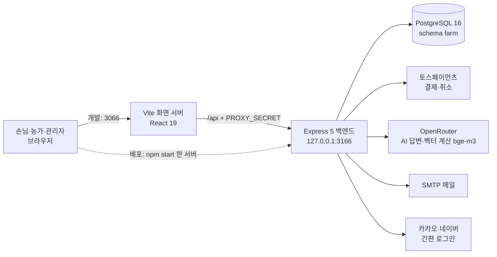

- **화면** `src/`: 손님(`src/shop`), 회원(`src/account`), 관리자(`src/admin`), 판매자(`src/seller`). 관리자·판매자·회원·장바구니·주문 화면은 그 주소에 들어갈 때 따로 받는다(첫 화면 JS gzip 약 79KB).
- **백엔드** `server/`: 한 파일이 한 영역을 맡는다.

| 파일 | 하는 일 |
|---|---|
| `index.js` | 서버 시작, 상품 목록·상세·검색·제철 API, 정리 작업(5분) |
| `search.js` | 검색어 → SQL 조건 (띄어쓰기·다른 말·카테고리) |
| `sellers.js` · `seller.js` | 판매자 가입·승인·자동 승인 / 판매자 센터 API |
| `admin.js` · `items.js` · `validate.js` | 관리자 상품·품목 검수 / 입력 검사 |
| `orders.js` · `payments.js` · `returns.js` | 주문·결제·농가별 배송·부분 취소 / 토스 / 반품·환불 |
| `account.js` · `oauth.js` · `auth.js` | 손님 회원·마이페이지 / 간편 로그인 / 관리자·판매자 로그인·2단계 인증 |
| `chat.js` · `rag.js` · `similar.js` · `ai.js` | 상담 / 벡터 검색 / 비슷한 질문 / OpenRouter 호출 |
| `inquiry.js` · `reviews.js` · `restock.js` | 상품 문의·기업 문의 / 후기 / 재입고 알림 |
| `recommend.js` · `brix.js` · `notice.js` · `content.js` | 추천 / 당도 등급 / 고시 / AI 상세 초안 |
| `crypto.js` · `pii.js` · `privacy.js` · `limit.js` · `banned.js` | 암호화 / 개인정보 / 민감정보 막기·가리기 / 요청 제한 / 금지어 |
| `mailer.js` · `policy.js` · `web.js` · `cache.js` · `db.js` | 메일 / 정책·약관 / SEO·배포 화면 / 잠깐 기억 / DB 연결 |
| `schema.sql` | 테이블 구조 (서버를 켤 때 자동으로 맞춘다) |

- **주요 테이블**: `sellers`(농가) · `items`(품목 기준표) · `products` · `product_options` · `product_changes`(수정 이력) · `orders` · `order_items` · `order_shipments`(농가별 배송) · `order_refunds`(돌려준 돈 기록) · `order_returns` · `customers` · `customer_identities`(간편 로그인) · `questions` · `reviews` · `restock_requests` · `email_outbox` · `chat_logs` · `rag_chunks` · `admins` · `access_logs` · `banned_words`.
- **데이터** `data/`: 품목·농가·상품·옵션·태그·질문 CSV(예시). 형식: [docs/data_guide.md](docs/data_guide.md)
- **빠르게**: 상품 목록·상세 15초, 제철 60초 동안 결과를 기억(바뀌면 바로 지움). 글자 응답 gzip, 빌드 파일 1년 캐시, 사진 lazy 로딩. 공용 DB는 계정당 연결 5개라 서버는 3개만 쓴다(`DB_POOL_MAX`).
- **검색엔진**: 상품 주소 `/p/상품코드`를 열면 서버가 상품 이름·설명·가격·사진·별점(schema.org Product)을 HTML에 넣는다. `/sitemap.xml`에 판매 중인 모든 상품.

---

## 11. 실행하기 · 설정 · 시험

### 가장 쉬운 방법: GitHub Codespaces (설치 없이)
1. 저장소 → 초록색 **Code** → **Codespaces** → **Create codespace on main**
2. 2~3분 뒤 DB 설치 → `.env` 만들기 → 예시 데이터 → 쇼핑몰 실행까지 자동으로 끝나고 새 탭에 화면이 열린다 (안 열리면 **PORTS** 탭의 3066 지구본 아이콘)
3. 관리자 화면: 터미널에서 `npm run create-admin -- 아이디` → 주소 뒤에 `/admin`
4. 다 쓰면 Codespaces 목록에서 **Stop** (개인 계정 한 달 약 60시간 무료)

### 내 컴퓨터 (Node.js 22 + PostgreSQL 16)
```bash
git clone https://github.com/dibo1206/ax-board.git && cd ax-board
npm install
npm run setup        # .env 자동 생성 (DATABASE_URL 을 내 PostgreSQL 에 맞게)
npm run load-data    # 예시 데이터 넣기 (먼저 CREATE DATABASE farm_mall;)
npm run demo         # 화면 + 백엔드 → http://localhost:3066
```

### 실습 서버
```bash
cp .env.sample .env && chmod 600 .env   # DATABASE_URL, SESSION_SECRET, PROXY_SECRET, DATA_KEY 채우기
npm run load-data                        # data/*.csv 검사 후 DB에 넣기 (검사만: -- --check)
npm run server                           # 터미널 1 — 백엔드 ($PORT + 100)
npm run dev                              # 터미널 2 — 화면 ($PORT)
```
다른 사람이 보려면 서버에 SSH 터널을 연다: `ssh -N -L 3066:127.0.0.1:3066 아이디@서버` → `http://localhost:3066`

### 배포 (서버 하나로)
```bash
npm run build && npm start               # $PORT 에서 화면 + API 함께 (Vite 없이)
```
`PUBLIC_URL`(https://도메인)을 꼭 넣는다. 클라우드 서버로 옮기는 방법(systemd, nginx + HTTPS, 백업, 열기 전 점검표): [docs/deploy.md](docs/deploy.md)

### 계정 만들기
```bash
npm run company-content                                     # 회사 실제 제품 11개와 공지·언론보도 넣기 (여러 번 해도 같다)
npm run create-admin -- farm_admin                          # 회사 관리자 (비밀번호는 실행하면 물어봄)
npm run create-admin -- sunny_farm --seller farm_sunny      # 판매자 계정을 직접 만들 때
npm run admin-2fa -- farm_admin                             # 2단계 인증 등록 (해제: -- 아이디 --off)
```

### 설정 (`.env`, 예시는 `.env.sample`)

| 이름 | 뜻 |
|---|---|
| `DATABASE_URL`, `DB_POOL_MAX` | DB 주소, 연결 수(기본 3) |
| `SESSION_SECRET` | 로그인 쿠키 서명 키 |
| `DATA_KEY` | 개인정보 암호화 키 (**잃어버리면 복구 불가**, 따로 보관) |
| `PROXY_SECRET` | 화면 서버 → 백엔드 요청 확인 값 (공유 서버) |
| `TRUST_PROXY_HOPS` | 앞에 nginx 같은 프록시가 있으면 그 수(보통 1), 없으면 0 |
| `PUBLIC_URL` | 사이트 주소 (메일 링크·검색엔진·공유 미리보기) |
| `TOSS_CLIENT_KEY`, `TOSS_SECRET_KEY` | 토스페이먼츠 키. 없으면 개발용 테스트 결제, 운영에서는 키 없이 주문을 받지 않음 |
| `OPENROUTER_API_KEY`, `CHAT_MODEL` | AI 답변·벡터 계산 키, 모델 목록 |
| `AI_DAILY_LIMIT`, `AI_DAILY_PER_USER` | 하루 AI 호출 상한 (0이면 AI 끔) |
| `RAG_ENABLED` | 0이면 벡터 검색 끔 |
| `ADMIN_ALLOWED_IPS`, `REQUIRE_2FA` | 관리자 IP 제한, 2단계 인증 필수 |
| `SMTP_HOST` · `SMTP_PORT` · `SMTP_SECURE` · `SMTP_USER` · `SMTP_PASS` · `MAIL_FROM` · `ADMIN_EMAIL` | 메일 (비우면 보내지 않고 기록만) |
| `KAKAO_CLIENT_ID` · `KAKAO_CLIENT_SECRET` · `NAVER_CLIENT_ID` · `NAVER_CLIENT_SECRET` | 간편 로그인 |
| `OAUTH_MOCK` | 1이면 개발용 시험 로그인 (공개 서버에는 쓰지 않기) |
| `CLOUDFLARE_ACCOUNT_ID`, `CLOUDFLARE_AI_TOKEN`, `IMAGE_DAILY_LIMIT` | 레시피 사진 AI로 만들기 (Cloudflare Workers AI). 비우면 사진 올리기만 |

### 시험과 시뮬레이션

| 명령 | 무엇을 보나 | 최근 결과 |
|---|---|---|
| `npm run lint` · `npm run build` | 코드 검사 · 화면 빌드 | 0건 · 통과 |
| `npm run test-resilience` | 결제 통신 끊김·서버 재시작·DB 끊김에도 돈과 주문이 어긋나지 않는지 (가짜 결제 서버) | 13/13 |
| `npm run test-refund` | 부분 취소·전체 취소·반품 환불·판매자 권한 | 33/33 |
| `npm run test-submit` | 판매자 상품 저장 규칙 → `docs/test_results.md` | 10/10 |
| `npm run chat-eval` | 챗봇 질문 348개 (AI 없이) → `docs/chat_eval_report.md` | 정답 240, 자신 있게 틀림 0 |
| `npm run test-rag` · `npm run rag-eval -- test` | 벡터 검색 자동 반영 · 검색 평가 | [docs/rag_eval.md](docs/rag_eval.md) |
| `npm run count-ai` | AI 없이 답하는 비율 (토큰 0) | |
| `npm run simulate-farms` → `npm run onboard-farms` | 예시 농가 10곳·상품 100개가 가입 → 승인 → 등록 순서로 실제 API를 거쳐 들어온다 | [docs/farm_onboarding.md](docs/farm_onboarding.md) |
| `npm run sim-admin` | 관리자·농가 일을 시험 계정으로 해 보고 화면 숫자와 DB를 맞춰 봄 | 맞음 37 · 어긋남 0 |
| `npm run live-sim` | 30분 동안 손님 50명·농가·관리자를 실제 API로 움직여 매출·재고·오류를 맞춰 봄 | 결제 10건, 검사 6개 맞음, 서버 오류 0 |

공용 DB 연결이 적은 서버에서 시험을 돌릴 때는 `DB_POOL_MAX=1`을 붙인다.

---

## 12. 아직 못 한 것과 정해야 할 것

- **배포 주소**: 아직 누구나 여는 주소가 없다(실습 서버는 터널로만).
- **실제 결제**: 토스 계약 전. 테스트 결제와 가짜 결제 서버로만 확인했고, 실제 테스트 키의 부분 취소·환불은 확인하지 않았다.
- **간편 로그인**: 카카오·네이버 키가 없어 시험 로그인으로만 확인했다.
- **운영 서버 점검**: HTTPS, 방화벽, 백업 복원을 실제 환경에서 점검하지 않았다. 외부 보안 점검도 받지 않았다.
- **실제 데이터**: 상품·가격·농가·당도·제철 달은 모두 `[예시]`. 상품 사진(Figma AI 40장)과 레시피 사진(78개 중 34장)은 시연용 AI 이미지라 실물 사진으로 바꿔야 한다. 검수자 칸이 빈 품목의 보관·안전 정보는 AI 초안이라 식품 검수가 필요하다. 약관·처리방침은 법률 검토 전.
- **메일**: 메일 서버를 연결하지 않아 실제로 보내지 않고 기록만 남는다.
- **챗봇**: 팀 밖 새 질문은 아직 담당자 안내로 넘기는 비율이 높다. 포장·제주 배송·쿠폰·현금영수증처럼 회사 정책이 필요한 질문은 자료가 없어 담당자에게 넘긴다.
- **회사 제품**: 가격·재고는 [예시]이고, 청포도·딸기 베이스와 과일세트·배즙은 라벨 정보를 회사에 받아야 한다. 회사 상세페이지의 '단순 변심 교환·반품 불가' 안내는 우리 교환·환불 정책(단순 변심 7일)과 달라 옮기지 않았다 → 회사가 정할 것.
- **공지 게시판**: 관리자 화면에서 글에 사진을 올리는 기능은 아직 없다(서버 `public/posts/` 폴더의 파일 주소만 넣을 수 있다).
- **없는 기능**: 쿠폰, 적립금, 정기배송.
- **회사가 정할 것** `[가설]`: 배송비·무료 배송 기준, 반품 정책 문구, 예약 상품과 일반 상품을 함께 샀을 때 따로 보낼지, 농가별 구매 확정, 자동 승인 기준(지금 3개), 제철 달력 순서(지금은 과일 먼저).

---

## 13. 더 자세한 문서

| 문서 | 내용 |
|---|---|
| [docs/PRD.md](docs/PRD.md) | 기획: 문제·기능·성공 기준 |
| [docs/api_security.md](docs/api_security.md) | 보안 점검표, 배포할 때 할 일 |
| [docs/deploy.md](docs/deploy.md) | 범용 서버로 옮기기 (systemd · nginx · HTTPS · 백업) |
| [docs/data_guide.md](docs/data_guide.md) | 데이터 CSV 형식과 바꾸는 법 |
| [docs/rag_design.md](docs/rag_design.md) · [docs/rag_eval.md](docs/rag_eval.md) | 벡터 검색 설계와 평가 |
| [docs/chat_eval_report.md](docs/chat_eval_report.md) | 챗봇 평가 결과 |
| [docs/farm_simulation.md](docs/farm_simulation.md) · [docs/farm_onboarding.md](docs/farm_onboarding.md) | 예시 농가·상품을 만든 근거와 가입 과정 |
| [docs/admin_simulation.md](docs/admin_simulation.md) · [docs/live_simulation.md](docs/live_simulation.md) | 관리자 시뮬레이션 · 실시간 운영 시뮬레이션 |
| `server/chat_rules.md` | 상담 규칙 (식품팀·기획팀이 고쳐도 됨) |
| `src/shop/home/content.js` | 첫 화면 글·사진·제철 달력·자주 묻는 질문 (기획·디자인팀은 이 파일만 고치면 됨) |
